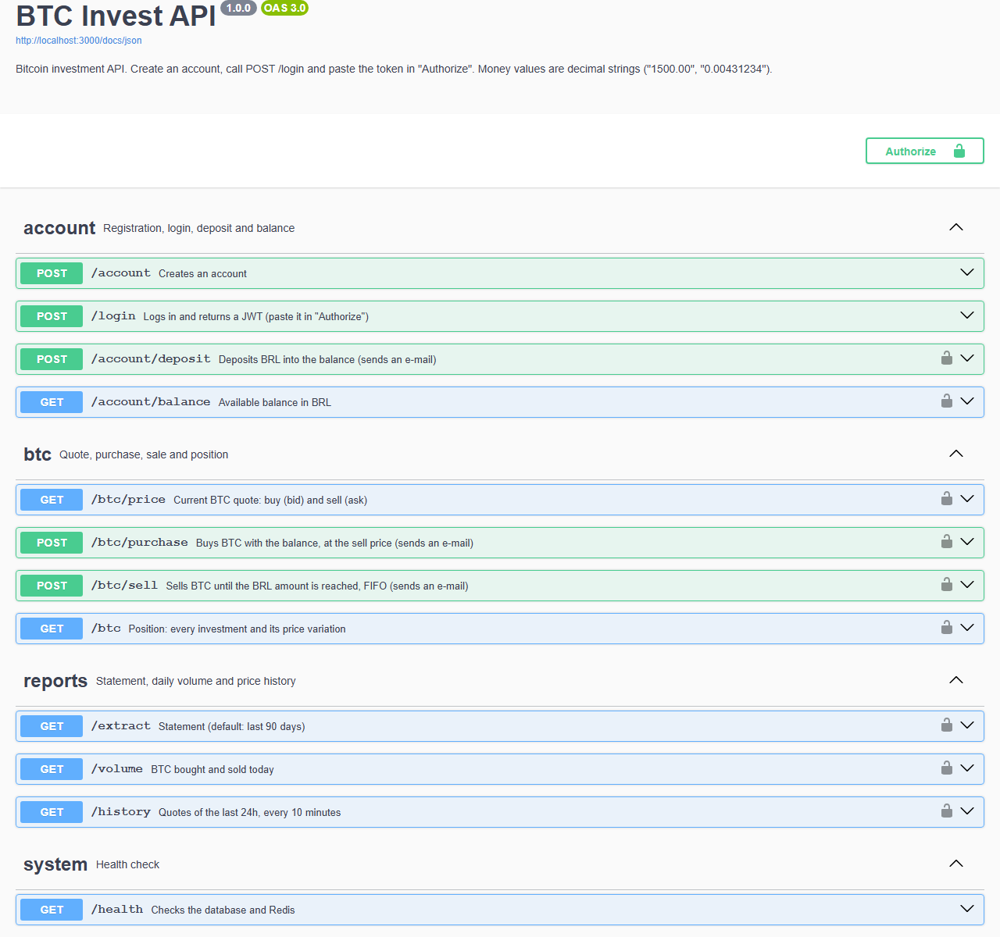
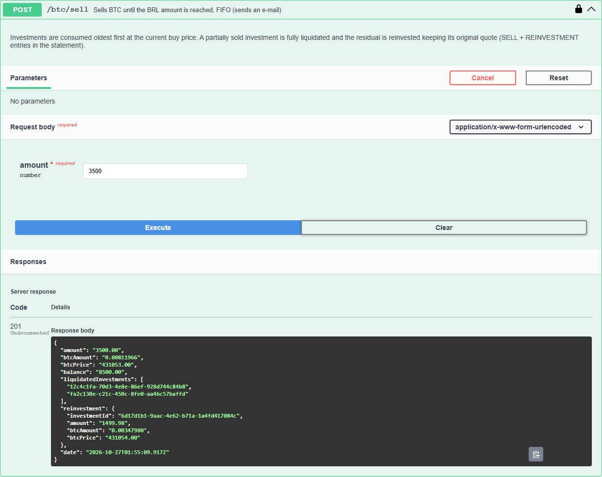

# BTC Invest API

API de investimento em Bitcoin: cadastro e login com JWT, depósitos em reais, compra e venda de BTC pela cotação do Mercado Bitcoin, posição dos investimentos, extrato, volume diário e histórico de cotações de 10 em 10 minutos.

**Stack:** Node.js 22 · TypeScript · Fastify 5 · PostgreSQL 16 · TypeORM (migrations) · Redis (cache + filas BullMQ) · Zod · SendGrid · Docker

Documentação interativa (Swagger) em `http://localhost:3000/docs`, com todos os endpoints testáveis pelo navegador:



---

## Como executar (Linux)

### Opção 1 — Tudo com Docker (recomendado)

Pré-requisitos: Docker e Docker Compose.

```bash
cp .env.example .env          # ajuste JWT_SECRET (e SENDGRID_API_KEY, se quiser e-mails reais)
docker compose up -d --build  # postgres, redis, migrations, api e worker
curl http://localhost:3000/health
```

A API sobe em `http://localhost:3000` e a **documentação interativa (Swagger)** em **`http://localhost:3000/docs`**: crie uma conta, faça login, clique em **Authorize**, cole o token e teste todos os endpoints pelo navegador. As migrations rodam automaticamente (serviço `migrate`) antes da API e do worker.

Logs: `docker compose logs -f api worker`

### Opção 2 — Node local + infraestrutura no Docker

Pré-requisitos: Node.js 22+ e Docker.

```bash
cp .env.example .env
docker compose up -d postgres redis   # só a infraestrutura
npm install
npm run migrate                       # cria as tabelas
npm run dev                           # API em modo watch (terminal 1)
npm run dev:worker                    # worker: e-mails e jobs agendados (terminal 2)
```

> **Sem internet ou com a API do Mercado Bitcoin fora do ar?** Use `QUOTE_PROVIDER=fake` no `.env`: a cotação passa a ser gerada localmente (oscila em torno de R$ 350 mil).

> **E-mails:** com `SENDGRID_API_KEY` preenchida, os e-mails são enviados pelo SendGrid (tier gratuito; o `MAIL_FROM` precisa ser um remetente verificado). Sem a chave, o worker registra o conteúdo do e-mail no log — útil para avaliar sem criar conta.

### Build de produção

```bash
npm run build
npm run migrate:prod
npm start             # API
npm run start:worker  # worker
```

## Testes

**Só com Docker** (sem instalar Node): roda os testes unitários e os ponta a ponta dentro de um container, com PostgreSQL e Redis reais, e encerra mostrando o resultado.

```bash
docker compose run --rm --build test
```

O serviço `test` fica num _profile_ separado: o `docker compose up` normal não o inicia, e a imagem da API não leva os testes. Ele usa um banco próprio (`btc_invest_test`) e o database `1` do Redis, então não apaga os dados da aplicação.

**Com Node 22 local:**

```bash
npm test            # unitários + HTTP (sem banco, Redis ou internet)
npm run test:e2e    # ponta a ponta com PostgreSQL e Redis reais
npm run typecheck
npm run lint
```

- **`npm test`** cobre as regras de negócio (dinheiro em inteiros, FIFO, reinvestimento, posição, extrato, volume, histórico) e a camada HTTP inteira via `fastify.inject`, usando adaptadores em memória.
- **`npm run test:e2e`** precisa de `docker compose up -d postgres redis` e usa o banco de `TEST_DATABASE_URL` (as tabelas dele são **apagadas** a cada execução) e o Redis de `TEST_REDIS_URL` (padrão: database lógico `1`, para não apagar as filas da aplicação). Inclui um teste de concorrência: 6 compras simultâneas com saldo para 2 → exatamente 2 aprovadas e saldo final zero.
- **`npm run demo:swagger`** é uma demonstração visual com Playwright: com a API no ar, abre um navegador e usa o Swagger sozinho em 18 passos (cadastro, login, Authorize, depósito, compra, venda parcial, extrato, volume, histórico e casos de erro). Ele preenche os formulários, clica em Execute e confere o status HTTP de cada resposta. Antes, rode `npx playwright install chromium` uma vez. `DEMO_HEADLESS=true` roda sem janela; `DEMO_VIDEO_DIR=pasta` grava um vídeo `.webm`.
- Há um workflow do GitHub Actions (`.github/workflows/ci.yml`) rodando typecheck, lint, testes e build.

## Endpoints

Todas as rotas, exceto `POST /account`, `POST /login`, `GET /health` e `/docs`, exigem `Authorization: Bearer <token>`.
Valores monetários vão e voltam como **string decimal** (`"1500.00"`, `"0.00431234"`) para não perder precisão em clientes JavaScript. Na entrada, `amount` aceita número ou string com até 2 casas decimais. Os corpos podem ser enviados em JSON ou como formulário (`application/x-www-form-urlencoded`) — é o que permite ao Swagger mostrar um campo para cada valor.

| Método | Rota                 | Descrição                                                          | Sucesso   |
| ------ | -------------------- | ------------------------------------------------------------------ | --------- |
| POST   | `/account`           | Cadastro `{ name, email, password }`                               | 201       |
| POST   | `/login`             | Login `{ email, password }` → `{ token }`                          | 200       |
| POST   | `/account/deposit`   | Depósito em reais `{ amount }` + e-mail                            | 201       |
| GET    | `/account/balance`   | Saldo disponível em reais                                          | 200       |
| GET    | `/btc/price`         | Cotação atual: `buy` (compra) e `sell` (venda)                     | 200       |
| POST   | `/btc/purchase`      | Compra de BTC com o saldo `{ amount }` + e-mail                    | 201       |
| GET    | `/btc`               | Posição dos investimentos                                          | 200       |
| POST   | `/btc/sell`          | Venda/resgate em reais `{ amount }` + e-mail                       | 201       |
| GET    | `/extract?from=&to=` | Extrato (padrão: últimos 90 dias)                                  | 200       |
| GET    | `/volume`            | Total de BTC comprado e vendido hoje                               | 200       |
| GET    | `/history`           | Cotações das últimas 24h, de 10 em 10 min                          | 200       |
| GET    | `/health`            | Verifica banco e Redis                                             | 200 / 503 |
| GET    | `/docs`              | Documentação interativa (Swagger UI); spec OpenAPI em `/docs/json` | 200       |

Erros seguem sempre o formato `{ "error": { "code", "message", "details?" } }`:
`400` validação · `401` não autenticado/credenciais inválidas · `404` não encontrado · `409` e-mail já cadastrado · `422` saldo ou investimento insuficiente · `429` excesso de requisições · `503` cotação indisponível.

Uma collection do Postman está em [`docs/btc-invest.postman_collection.json`](docs/btc-invest.postman_collection.json) (o request de login salva o token automaticamente).

<details>
<summary>Exemplos de resposta</summary>

`GET /btc`

```json
{
  "quote": { "buy": "331100.00", "sell": "332000.00", "date": "2026-10-26T15:00:00.000Z" },
  "investments": [
    {
      "id": "c0a8...",
      "purchasedAt": "2026-10-20T13:12:45.000Z",
      "investedAmount": "3010.00",
      "btcAmount": "0.01000000",
      "btcPriceAtPurchase": "301000.00",
      "priceVariationPercent": 10,
      "currentGrossAmount": "3311.00"
    }
  ],
  "totals": {
    "investedAmount": "3010.00",
    "btcAmount": "0.01000000",
    "currentGrossAmount": "3311.00"
  }
}
```

`POST /btc/sell` `{ "amount": 1000 }`

```json
{
  "amount": "1000.00",
  "btcAmount": "0.00302024",
  "btcPrice": "331100.00",
  "balance": "7990.00",
  "liquidatedInvestments": ["c0a8..."],
  "reinvestment": {
    "investmentId": "7f3e...",
    "amount": "2311.00",
    "btcAmount": "0.00697976",
    "btcPrice": "301000.00"
  },
  "date": "2026-10-26T15:01:10.000Z"
}
```

`GET /extract?from=2026-10-01&to=2026-10-31` — datas ISO 8601; datas sem horário usam o fuso `APP_TIMEZONE` e o `to` inclui o dia inteiro.

```json
{
  "from": "2026-10-01T03:00:00.000Z",
  "to": "2026-11-01T02:59:59.999Z",
  "items": [
    {
      "id": "…",
      "type": "DEPOSIT",
      "date": "…",
      "amount": "10000.00",
      "btcAmount": null,
      "btcPrice": null,
      "investmentId": null
    },
    {
      "id": "…",
      "type": "PURCHASE",
      "date": "…",
      "amount": "3010.00",
      "btcAmount": "0.01000000",
      "btcPrice": "301000.00",
      "investmentId": "c0a8..."
    },
    {
      "id": "…",
      "type": "SELL",
      "date": "…",
      "amount": "3311.00",
      "btcAmount": "0.01000000",
      "btcPrice": "331100.00",
      "investmentId": "c0a8..."
    },
    {
      "id": "…",
      "type": "REINVESTMENT",
      "date": "…",
      "amount": "2311.00",
      "btcAmount": "0.00697976",
      "btcPrice": "301000.00",
      "investmentId": "7f3e..."
    }
  ]
}
```

</details>

## Regras de negócio e decisões

- **Precisão:** nenhum cálculo financeiro usa ponto flutuante. Reais são guardados em **centavos** e BTC em **satoshis** (`bigint` no Postgres e no código). Os arredondamentos nunca criam dinheiro ou BTC do nada: na compra, o BTC entregue é arredondado para baixo; na venda, os satoshis necessários são arredondados para cima.
- **Cotação:** `buy` é o preço que o mercado paga (bid) e `sell` o preço cobrado (ask). A **compra** converte reais pela cotação de **venda** (como pede o enunciado). A **venda** e a **posição** usam a cotação de **compra**, que é o valor que o cliente efetivamente receberia ao vender.
- **Venda (FIFO):** os investimentos são consumidos do mais antigo para o mais novo, pela cotação do momento, até atingir o valor pedido. O saldo recebe exatamente o valor solicitado.
- **Venda parcial:** o investimento é **liquidado por completo** (lançamento `SELL`) e o troco é **reinvestido** (lançamento `REINVESTMENT`), mantendo a cotação e a data originais. Veja [a decisão e um exemplo](#venda-parcial-como-o-reinvestimento-foi-interpretado) abaixo.
- **Volume:** soma de BTC comprado e vendido na plataforma no dia corrente (fuso `APP_TIMEZONE`). Reinvestimentos são movimentos internos, então são descontados do volume vendido.
- **Histórico:** um job grava a cotação em slots de 10 minutos (08:00, 08:10, 08:20…); `/history` devolve as últimas 24 horas. Outro job diário apaga dados com mais de 90 dias.
- **Extrato:** depósitos, compras, vendas e reinvestimentos com data e cotação; padrão dos últimos 90 dias ou intervalo customizado.
- **E-mails:** depósito, compra e venda geram e-mails enviados de forma assíncrona por fila. Uma falha no envio nunca desfaz a operação financeira (e é reprocessada com backoff exponencial).

### Venda parcial: como o reinvestimento foi interpretado

O enunciado diz que, numa venda parcial, o investimento é liquidado e o troco é _"reinvestido pela cotação original"_. A frase admite duas leituras; a diferença aparece quando o preço muda.

**Exemplo:** comprei R$ 1.000 com o BTC a R$ 100.000 → **0,01 BTC**. O BTC sobe para R$ 200.000 (o investimento vale R$ 2.000) e eu saco **R$ 500**. O investimento é liquidado (R$ 2.000), recebo R$ 500 e sobra um troco de **R$ 1.500**.

| Leitura     | Como o troco vira BTC                              | BTC depois do saque | Resultado                                                                                                                           |
| ----------- | -------------------------------------------------- | ------------------- | ----------------------------------------------------------------------------------------------------------------------------------- |
| Literal     | R$ 1.500 ÷ R$ 100.000 (cotação antiga)             | **0,015 BTC**       | ❌ o cliente tinha 0,01 BTC, sacou dinheiro e ficou com **mais** BTC: 0,005 BTC (≈ R$ 1.000) criados do nada, pagos pela plataforma |
| **Adotada** | mantém os satoshis que não precisaram ser vendidos | **0,0075 BTC**      | ✅ R$ 500 no saldo + 0,0075 BTC (= R$ 1.500 a preço de hoje): nada é criado nem perdido                                             |

Na leitura adotada, o novo investimento guarda a **cotação original (R$ 100.000) como referência** e a **data original**, então a posição continua mostrando a variação real (+100%) e ele mantém o lugar na fila FIFO.

No extrato, o lançamento `REINVESTMENT` traz o **valor do troco a preço de hoje** (R$ 1.500, para que `SELL − REINVESTMENT` = valor sacado) e a **cotação original** como referência. Por isso, quando o preço mudou, `valor ÷ cotação` não é igual à quantidade de BTC — é esperado, e a quantidade mostrada é a que de fato ficou investida.

Uma venda parcial de R$ 3.500 executada no Swagger, com dois investimentos (R$ 3.000 + R$ 2.000): os dois são liquidados (FIFO), o saldo recebe exatamente R$ 3.500 e o troco volta como reinvestimento:



## Arquitetura

Arquitetura hexagonal (ports & adapters) com camadas bem separadas — o domínio não conhece Fastify, TypeORM, Redis nem HTTP:

```
src/
├── domain/                  # regras puras, sem dependências externas
│   ├── entities.ts          # Account, Investment, Transaction, Quote...
│   ├── money.ts             # aritmética de centavos/satoshis (bigint)
│   ├── errors.ts            # erros de negócio (mapeados para HTTP na borda)
│   └── services/            # sell-planner (FIFO + reinvestimento), position
├── application/
│   ├── ports.ts             # interfaces: repositórios, UnitOfWork, cotação, notificador...
│   └── use-cases/           # um caso de uso por arquivo
├── infra/                   # adaptadores
│   ├── database/            # TypeORM (EntitySchema), repositórios, migrations
│   ├── quotes/              # Mercado Bitcoin, cache Redis, provedor fake
│   ├── queue/               # BullMQ (filas, agendamentos, notificador)
│   ├── mail/                # SendGrid / log + templates
│   └── security/            # bcrypt
├── http/                    # Fastify: rotas, validação (Zod), presenters, erros
├── main/container.ts        # composition root (injeção de dependências)
├── server.ts                # processo da API
└── worker.ts                # processo de background (e-mails e jobs)
```

- **Consistência e concorrência:** cada operação financeira roda em uma transação (`UnitOfWork`) e trava a linha da conta (`SELECT … FOR UPDATE`). Duas requisições simultâneas nunca gastam o mesmo saldo; o banco ainda tem `CHECK (balance_cents >= 0)` como última barreira.
- **Escalabilidade:** API sem estado (JWT), cache de cotação e contador de rate limit compartilhados no Redis, e o worker é um processo separado — API e worker escalam de forma independente (`docker compose up --scale api=3` atrás de um balanceador).
- **Cache:** a cotação fica 10 s no Redis, protegendo a API externa de picos; se ela cair, a última cotação conhecida (até 5 min) é usada.
- **Segurança:** senhas com bcrypt, JWT com expiração, `helmet`, CORS configurável, rate limit global e mais restrito no login (anti força bruta), resposta de login que não revela se o e-mail existe (inclusive no tempo de resposta), validação de todas as entradas, limite de tamanho de corpo e redação de senhas/tokens nos logs.
- **Logs:** estruturados com pino (JSON em produção, formatados em desenvolvimento).
- **Migrations:** o schema só muda por migrations versionadas (`synchronize` desligado).

## O que eu faria a seguir

- Paginação no extrato.
- Refresh token e revogação de sessões.
- Idempotency key nos POSTs financeiros (evita duplicidade em retries do cliente).
- Métricas (Prometheus) e tracing.
